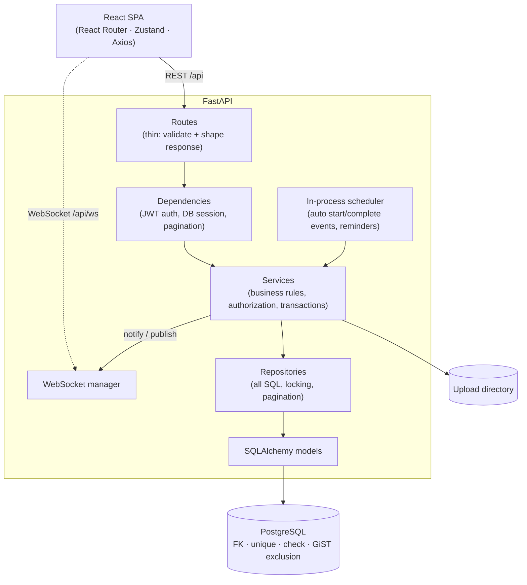

# Architecture

## Layers
| Layer | Responsibility | Where |
|---|---|---|
| Routes | HTTP shape, response envelope, no business logic | `app/api/routes/` |
| Dependencies | JWT → current user, DB session, pagination params | `app/api/deps.py` |
| Services | Business rules, authorization, transaction boundaries, notifications, audit | `app/services/` |
| Repositories | Every query, `SELECT … FOR UPDATE`, filtering/sorting/pagination | `app/repositories/repos.py` |
| Models | Tables, constraints, indexes | `app/models/` |

## Authorization model (enforced server-side)
Three independent checks, all in `services/common.py` (`Access`) and `services/events.py`:

1. **Organization level** – every request resolves the caller's *active* membership in the target org. Non-members get `403 ORGANIZATION_ACCESS_DENIED` on org endpoints and `404` on child objects (events, resources, bookings…) so existence is never leaked across tenants.
2. **Role level** – ranked `participant < staff < event_manager < org_admin` (super admin bypasses org checks).
3. **Resource/event level** – an event manager may only modify events they organize; users only touch their own registrations, bookings, comments and uploads; participants see only their own registrations/attendance and never see drafts.

| Action | Participant | Staff | Event Manager | Org Admin |
|---|---|---|---|---|
| View published events / sessions / own registrations | ✔ | ✔ | ✔ | ✔ |
| Register / cancel own registration | ✔ | ✔ | ✔ | ✔ |
| Approve/reject registrations, mark attendance | | ✔ | ✔ | ✔ |
| Request resource bookings, upload event files | | ✔ | ✔ | ✔ |
| Create/edit **own** events, sessions, speakers; approve bookings | | | ✔ | ✔ |
| Manage **any** event; resources; members; audit log | | | | ✔ |

## Concurrency strategy
| Risk | Defence |
|---|---|
| Overbooking an event | `SELECT … FOR UPDATE` on the event row serialises register/cancel/approve/promote; seat count is read under the lock |
| Duplicate registration | Partial unique index `(event_id, user_id) WHERE status NOT IN ('cancelled','rejected')` + service check |
| Waitlist promotion | Runs inside the cancelling transaction, FIFO by `waitlist_entries.created_at` (`clock_timestamp()`), `FOR UPDATE` on the entry |
| Double-booked resource | Resource row lock **and** PostgreSQL `EXCLUDE USING gist (resource_id WITH =, tstzrange(start,end) WITH &&) WHERE status IN ('requested','approved')` — correct even if app code is bypassed |
| Room clash between sessions | Room row lock + `EXCLUDE` constraint on `event_sessions` |
| Speaker double-assignment | Speaker rows locked in id order (deadlock-free) before the overlap check |
| Refresh-token replay | Rotation with `FOR UPDATE`; reuse of a rotated token revokes the whole token family |

## Real-time
Services call `notify()` / `broadcast()`, which persist notifications and *queue* WebSocket pushes on the SQLAlchemy session. A `after_commit` hook flushes the queue, so clients never receive events for rolled-back work. REST (`GET /api/notifications`) is the fallback and source of truth.
